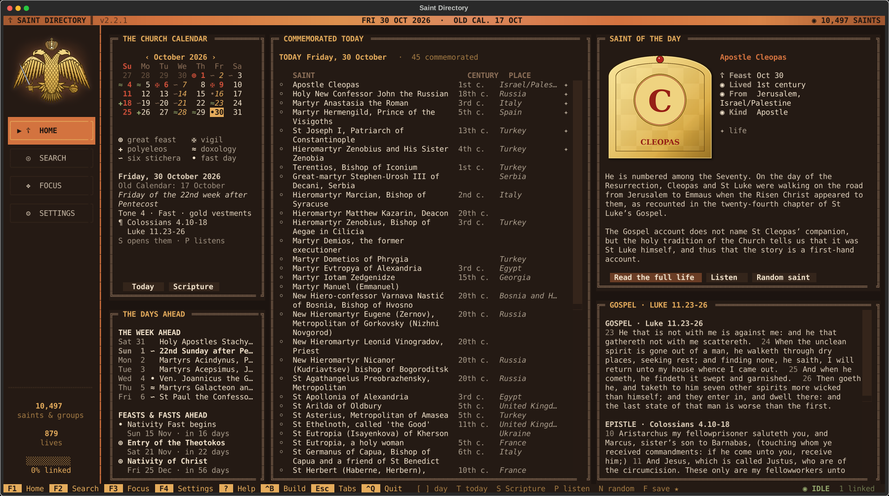
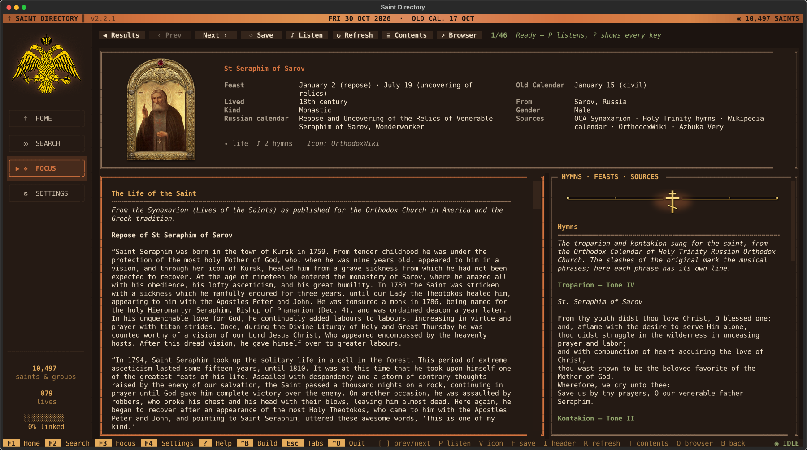
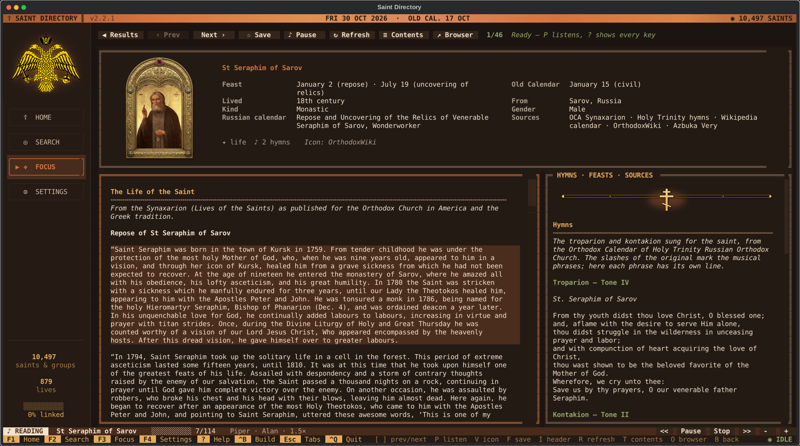

# ☦ Saint Directory (`saintd`)

A retro, earthy terminal guide to the saints of the Eastern Orthodox Church, for Linux, macOS and Windows.

Saint Directory builds a local directory of **~10,500 saints and groups** from free public sources and opens each one
like a page of the Synaxarion: the saint's **icon**, the **Life**, the **troparion and kontakion**, the **history**
from Wikipedia or OrthodoxWiki, feast days on the New and Old Calendars, and the saints who share them — and it can
**read it all to you aloud**. Home is a full-screen **Church calendar dashboard**: the typikon sign of every day, the
day's fast and readings with the Gospel's text, the saints, a saint of the day, and the feasts and fasts ahead.
Everything is in English — Russian-calendar entries and non-English articles are translated. In terminals that show
true images (Kitty, Ghostty and Sixel terminals) the icons stand in a gilded kiot and the double-headed eagle of the
Church of Greece heads the tab column.

```
F1 Home  F2 Search  F3 Focus  F4 Settings  P listen  ? Help  / search box  Esc tab column  ^B build  ^Q quit
```

| Home | Search |
|---|---|
|  |  |
| **Focus** (as drawn in Kitty and Ghostty) | **Reading aloud** |
|  |  |
| **The icon view (V)** | **Settings** |
|  |  |

All twelve colour schemes: [docs/themes.png](docs/themes.png)

---

## What's new in 2.5

- **macOS and Windows.** Saint Directory now runs on macOS and Windows as well as Linux. `install.sh` installs it on
  macOS too, and the new `install.ps1` installs it on Windows (see [Install](#install)). On Windows the directory,
  settings and icons are kept in your AppData folders.
- **Reading aloud on every system.** macOS reads with its own voices, Windows with its own voices, and Piper's
  natural voices work on all three. Pause and resume work there too: the sound stops at once, and Resume plays on
  from where it stopped.
- **Pictures on macOS and Windows.** Kitty and Ghostty on macOS show true images, as on Linux. Windows Terminal 1.22
  and newer shows still images (Sixel), and the Windows console and Terminal.app get colour blocks.
- **More on one screen.** Below 180×44 the tabs run in a strip along the top, the saints of the day take one row
  each, and from 120×30 Home is a three-column dashboard that fits the window without scrolling.
- **Cleaner upgrades.** `install.sh` removes files left over from an older version, checks your PATH, and
  `./install.sh --no-pipx` installs without pipx even when you have it.

## What's new in 2.4

- **More saints, from Wikidata.** Building the directory now also asks Wikidata for the saints it gives a feast day,
  keeps the ones it can tell are Eastern Orthodox (a title only the Orthodox use, such as passion-bearer or
  great-martyr; an Orthodox church named for the saint or the feast; "Orthodox" in a description; an entry in
  OrthodoxWiki or Drevo; the Orthodox faith as their religion), and adds those that none of the calendars has: mostly
  New Martyrs of the 20th century, and monastics and hierarchs of Russia, Georgia, Greece and Romania. It leaves out
  saints the Catholic Church canonized after the Schism, the saints of the Oriental churches, and those of the Old
  Believers and Old Calendarists. A saint the directory already has (on another day, in a group, or under another
  spelling) is not added again; one it misses is merged with it once background linking finds both are the same
  Wikidata item. Russian names are put into English the way the calendars' are ("Sabbas Krypetsky", "Arsenius the
  Lover of Labor"). Feast days are filed as church dates, and the saints' facts, picture and Wikipedia article come
  from Wikidata as for every other saint. An existing directory adds them the next time saintd starts;
  **Settings → Sources** can turn it off.
- **The eagle of the Church of Greece** (since 2.3). In Kitty and Ghostty (and Sixel terminals) the double-headed
  eagle at the head of the tab column is now the eagle of the flag of the Church of Greece, as it is drawn there:
  black lines on the flag's yellow, the closed crown above the two heads, the **sword** in its right claw and the
  **orb with the cross** in its left. Only the flag's ground is taken away.
- **Truer light behind it** (since 2.3). When you switch tabs the light behind the eagle swells and fades like a
  flare. It comes from behind the eagle, as from a lamp hung behind a carving: brightest right at its outline and
  falling away with the distance, with shafts of light breaking out between the wings, the heads and the crown. It
  swells fast, fades fast and then slowly, in sixteen steps; on the light scheme (Theophany) it is a tint of the
  scheme's colour.
  
- **A gilded kiot for the icons** (since 2.3). Icons now stand in a photographed gilded **kiot**, the case an icon
  stands in: a round arch with its running vine and rows of beads, the **three-bar cross** under the arch, the head of
  the opening cut in two arches that meet in a point under the cross, a **ruby** at the top and **silver rosettes**
  where the arch springs from the sides and at the lower corners. The frame is made to the shape of each icon (only
  the straight part of its sides grows or shrinks, so the arch, the cross and the corners are never distorted), the
  icon fills the opening, and the frame casts its shadow on it. A saint without a picture gets the painted icon blank
  in the same frame.

---

## Install

You need **Python 3.10 or newer** and `git`. No git? Click **Code → Download ZIP** at the top of this page, unzip it,
and run the installer from the unzipped folder instead of cloning.

### Linux

Ubuntu 22.04, Debian 12, Linux Mint 21 and anything newer already have Python 3.10. With `pipx` the install is
easiest:

```bash
sudo apt install git pipx python3-venv         # once (Debian, Ubuntu, Linux Mint)
pipx ensurepath                                 # once, then open a new terminal
git clone https://github.com/BravoDeltaThr33/saintd.git
cd saintd
./install.sh
saintd
```

### macOS

The Python that comes with macOS is too old. Install a newer one with [Homebrew](https://brew.sh) (or the installer
from [python.org](https://www.python.org/downloads/)); `git` comes with Apple's command-line tools, which macOS
offers to install the first time you use it.

```bash
brew install python pipx                        # once
pipx ensurepath                                 # once, then open a new terminal
git clone https://github.com/BravoDeltaThr33/saintd.git
cd saintd
./install.sh
saintd
```

Kitty and Ghostty show the icons as true pictures; Terminal.app shows them as colour blocks.

### Windows

In **Windows Terminal** (it comes with Windows 11; on Windows 10 get it from the Microsoft Store), install Python and
Git once, then open a new terminal:

```powershell
winget install Python.Python.3.13 Git.Git
```

Then:

```powershell
git clone https://github.com/BravoDeltaThr33/saintd.git
cd saintd
powershell -ExecutionPolicy Bypass -File install.ps1
```

Open a new terminal and start it with `saintd`. (`-ExecutionPolicy Bypass` lets this one script run; Windows
refuses to run scripts otherwise.)

### What the installers do

`install.sh` (Linux, macOS) and `install.ps1` (Windows) install with pipx when you have it, otherwise into a private
virtual environment in `~/.local/share/saintd-venv` (on Windows `%USERPROFILE%\.local\share\saintd-venv`), with
the `saintd` command in `~/.local/bin`. On Windows that folder is added to your PATH. They also add **Piper** for
natural reading voices. Without Piper, reading aloud uses the voices your computer has. If you add pipx later, the
next install uses it and removes the private environment. `./install.sh --no-pipx` (or `install.ps1 -NoPipx`) always
uses the private environment.

### Upgrading

In the folder you cloned, run `git pull` and then the installer again: `./install.sh`, or on Windows
`powershell -ExecutionPolicy Bypass -File install.ps1` (quit saintd first). This replaces the program and keeps your
directory, settings, saved saints, linked saints and downloaded voices. New dependencies are downloaded
automatically.

### Uninstalling

`pipx uninstall saint-directory`, or, without pipx, delete `~/.local/share/saintd-venv` and `~/.local/bin/saintd`
(on Windows `%USERPROFILE%\.local\share\saintd-venv` and `%USERPROFILE%\.local\bin\saintd.exe`). Your directory
and settings are kept apart: delete them too with `rm -rf ~/.local/share/saintd ~/.config/saintd ~/.cache/saintd`
(on Windows, the `saintd` folders in `%APPDATA%` and `%LOCALAPPDATA%`).

---

## Pictures in your terminal

saintd recognises the terminal *and its version* (from the environment and by asking the terminal itself: XTVERSION,
the Kitty graphics query, the cell size and the device attributes) and picks the best pictures it can really show:

| Terminal | Pictures | Notes |
|---|---|---|
| **Kitty** 0.28+ (Linux, macOS) | True images (Kitty graphics) | Best quality |
| **Ghostty** 1.0+ (Linux, macOS) | True images (Kitty graphics) | Best quality |
| WezTerm, foot, Konsole 22.04+, mlterm, xterm `-ti vt340`, iTerm2, Windows Terminal 1.22+ | True images (Sixel) | Detected from the terminal's answer |
| GNOME Terminal, Xfce Terminal, Tilix, Alacritty, Terminal.app, the Windows console, others with 24-bit or 256 colours | Colour-block mosaic | Two pixels per character cell |
| Inside tmux / screen | Colour-block mosaic | Multiplexers don't pass images on reliably |
| Linux console | Off | An ornamental frame with the saint's initial |

With true images (Kitty, Ghostty, Sixel) the icons stand in a **gilded kiot** made to the shape of each icon, and a
saint without a picture gets a **painted icon blank**: gold leaf, a halo with the initial, and the name inscribed.
The three-bar cross heads the hymns in Focus and the troparion and kontakion in the icon view, like the headpiece of
a page in a service book. **V** in Focus (or a click on the icon) shows the icon as large as the window allows, with
the troparion and kontakion beside it.

The **double-headed eagle** of the Church of Greece heads the tab column, painted for the size of your window (larger
on tall terminals). In Kitty and Ghostty the light behind it pulses when you switch tabs (by **F1–F4**, the tab
column, a click on a tab, **/**, or opening a saint, which takes you to Focus) and at nothing else; every step of the
light is sent to the terminal once, so the pulse costs nothing while you work.

You can choose yourself in **Settings → Display & Pictures** (Automatic, Kitty, Sixel, Colour blocks or Off), or for
one run with `SAINTD_GRAPHICS=blocks saintd`. Icons are downloaded only when you open a saint (or it is Saint of the
Day) and kept in `~/.cache/saintd/icons`; **Clear icon cache** in Settings empties it.

```bash
saintd --terminal      # what saintd knows about this terminal
```

---

## Reading aloud

Press **P**: in **Focus** the saint is read (name and facts, the life, the troparion and kontakion, then the
calendar notes and the history); on **Home** the day is read (its date and feasts, the fast, the saints, the saint
of the day, and the Epistle and Gospel); in **Search** the highlighted saint. The reading goes on while you move to
other tabs. The paragraph being read is highlighted and kept in view, and a bar above the status line shows what is
being read, how far it has got, the voice and the speed, with buttons for the mouse.

| Key | |
|---|---|
| **P** | Start reading — or pause and resume |
| **X** | Stop |
| **,** **.** (or **<** **>**) | Previous / next paragraph |
| **+** **-** | Faster / slower (0.7× – 1.75×) |

| Engine | Sound | Install |
|---|---|---|
| **Piper** (all) | Natural neural voices, offline. Voices (60–115 MB each: Alan, Ryan, Cori, Lessac, Northern English, John, Norman, Jenny…) are downloaded once from the [Piper voices](https://huggingface.co/rhasspy/piper-voices) collection — saintd offers some the first time you listen, and **Settings → Voice & Reading aloud** has them all | The installers add it; or `pipx inject saint-directory piper-tts`, or **Install Piper** in Settings |
| **macOS voices** | The voices of macOS (Samantha, Daniel, Karen…); System Settings → Accessibility → Spoken Content adds more, and its voice is the one used unless you choose another | Come with macOS |
| **Windows voices** | The voices of Windows (David, Zira…) | Come with Windows |
| **RHVoice** (Linux) | Clear classic voices | `sudo apt install rhvoice rhvoice-english` |
| **SVOX Pico** (Linux) | A clear female voice (British or American) | `sudo apt install libttspico-utils` |
| **eSpeak NG** (all) | Robotic but light, many accents | `sudo apt install espeak-ng`; on macOS `brew install espeak-ng`; on Windows the installer from [its releases](https://github.com/espeak-ng/espeak-ng/releases) |
| **Speech Dispatcher** (Linux) | The desktop's speech service and its voices | Usually installed already |
| **Festival** (Linux) | The classic Edinburgh system | `sudo apt install festival` |

*Automatic* picks the first that works, in the order shown, from the engines your system can have. Settings also
lists which engines and audio player this computer has, the voice in use, the speed, and switches for highlighting,
the hymns and the history. On Linux sound is played with `pw-play`, `paplay` or `aplay` (any of them is enough); macOS
plays it with `afplay` and Windows with its own sound system. Abbreviations, Scripture references and regnal numbers
are read in words ("Colossians 4.10-18" → "Colossians, chapter 4, verses 10 to 18"; "Joseph I" → "Joseph the First").

---

## First run

1. **Building the directory** starts automatically (a few minutes the first time; later updates take seconds because
   downloads are cached). You can use the app while it builds — Home and Search fill in as each stage finishes.
2. You'll be asked for an optional **contact e-mail or web address**. Wikimedia (Wikidata/Wikipedia) allows about
   **150 requests a minute** to apps that include contact details in their User-Agent, but only **10 a minute** to
   anonymous ones. The address is sent only to Wikimedia, inside the User-Agent header. You can add or change it
   later in **Settings → Network**, or press **Esc** to skip.
3. After the build, saints are **linked to Wikidata in the background** (dates, birthplaces, pictures, Wikipedia
   articles). Opening a saint in Focus always looks it up immediately.

---

## The tabs

The **tab column** on the left has the cursor when saintd starts: **Tab / Shift+Tab** (or ↑ ↓) move between tabs and
**Enter** (or →) steps into the page; **Esc** brings you back to it. **F1–F4** open a tab from anywhere. The page's
own keys (T, N, [ ], …) also work while the cursor is on the tab column.

Below 180 columns or 44 rows the tabs run along one row under the title bar instead, so the pages get the
column's width: there **← →** move between tabs and **↓** steps into the page, and the status
bar shows the open page's keys.

| Tab | What it shows |
|---|---|
| **Home** | The Church calendar: a month with the typikon sign of every day (⊕ great feast, ✠ vigil, ✚ polyeleos, ≈ doxology, ∽ six stichera, • fast day) and the Old Calendar date; the day's feasts, tone, fast, season, vestment colour and Scripture readings; the week ahead and the next feasts and fasts (Pascha is worked out on your computer); the saints commemorated that day (century, place, ✦ life, ♪ hymns); a Saint of the Day with an icon, facts, the Life and the troparion; and the Gospel and Epistle in full. On big terminals it is a three-column dashboard. |
| **Search** | Type a name or part of one, in any alphabet (*Серафим* or *Σεραφείμ* finds St Seraphim; spelling variants match: *athanasios* finds *Athanasius*, *cyril* finds *Kirill*). Filter by feast month/day, gender, century, country and kind of saint (Martyr, Hieromartyr, Monastic, Hierarch, Royal, Fool-for-Christ, Unmercenary…), or show only your saved saints. ✦ marks saints with a Life or article, ★ your saved ones. On wide terminals a preview of the highlighted saint stands beside the results; in Focus, **[ ]** steps through all of them. |
| **Focus** | One saint: a header card with the icon and every fact (feast days, Old Calendar date, dates, place, kind, sources); then the Life (from the Synaxarion, the Holy Trinity calendar, the Mystagogy Resource Center or Azbuka Very), the Hymns, the History (Wikipedia or OrthodoxWiki, translated if needed), the commemorations, the saints who share the day (click one to open it), and every source with its licence — on wide terminals the hymns, feast days and sources stand in a column beside the life. |
| **Settings** | Colour scheme and symbols, pictures, voice & reading aloud, New/Old Calendar, which sources to use, translator, network contact and timeout, directory maintenance (build, link, pause, retry, clear caches, delete) and information about every source. |

## Keys

Letter keys work in either case, and Ctrl keys with or without Shift. The mouse works too: click tabs, buttons, days
and saints, scroll with the wheel.

| Everywhere | |
|---|---|
| **F1 F2 F3 F4** | Home, Search, Focus, Settings |
| **/** | Jump to the search box |
| **?** | Help: every key, and a glossary of Orthodox terms (hieromartyr, troparion, typikon…); **?**, **Esc** or **Q** closes it — [screenshot](docs/help.png) |
| **Esc** | Put the cursor on the tab column |
| **Ctrl+B** | Build or update the directory |
| **Ctrl+Q** | Quit |
| **P** / **X** | Listen (pause, resume) / stop reading — see [Reading aloud](#reading-aloud) |

| Home | |
|---|---|
| **← → ↑ ↓** | Move the day on the calendar (when the calendar has the cursor) |
| **PgUp / PgDn** | Previous / next month (on the calendar) |
| **[ ]** | Previous / next day, from anywhere on Home |
| **T** (or **Home** on the calendar) | Today |
| **S** | The day's Scripture readings, with their text |
| **N** | A random saint |
| **P** | Listen to the day |
| **C / L / G** | Cursor to the calendar / to the list of the day's saints / to the Gospel and Epistle |
| **Enter** | Open the highlighted saint (on the calendar: go to the day's list) |
| **F** | Save / unsave the highlighted saint ★ (or the Saint of the Day) |

| Search | |
|---|---|
| **/** or **Ctrl+F** | Cursor to the search box |
| **Enter** | In the box: go to the results. On a result: open it in Focus |
| **↓** | From the search box down to the results |
| **F** | Save / unsave the highlighted saint ★ (on the results) |
| **P** | Listen to the highlighted saint (on the results) |
| **Ctrl+R** | Clear the search and every filter |

In the search box every letter is typed into the search; **↓** or **Enter** takes you to the results, where the keys
above work.

| Focus | |
|---|---|
| **↑ ↓ PgUp PgDn Home End** | Scroll the article |
| **Space** | One page down |
| **[ ]** | Previous / next saint of the list you came from |
| **P** | Listen: the life, hymns and history read aloud |
| **V** | The icon view: the icon as large as the window allows, with the hymns (or click the icon) |
| **F** | Save / unsave the saint ★ |
| **I** | Show or hide the header card (its facts then move into the article) |
| **R** | Refresh from the internet |
| **T** | Table of contents |
| **O** | Open the saint's page in your web browser |
| **B** | Back to the search results or the day's list, on the same saint |

### Colour schemes

| Theme | Palette |
|---|---|
| **Terracotta Kiln** | fired clay, ochre glaze and sage |
| **Moss & Lichen** | forest-floor greens over damp stone |
| **Desert Ochre** | sun-baked sand, rust and desert sage |
| **Icon Umber** | icon gold leaf, cinnabar and verdigris on walnut |
| **Cedar & Peat** | smoked cedar, olive branch and parchment |
| **Byzantine Empire** | porphyry purple, the gold ground of the mosaics, lapis blue and ivory |
| **Roman Empire** | legion crimson and eagle gold on Pompeian black, with laurel and Carrara marble |
| **Paschal Night** | candle flames, Paschal red and white lilies under the midnight sky |
| **Mount Athos** | monastic black, beeswax, olive groves and the Aegean |
| **Blue Domes** | the starry blue domes and gold stars of the Lavra, with brick |
| **Theophany** (light) | white garments, Jordan blue and gold, on ivory |
| **Liturgical Colours** | changes with the Church year like the vestments (after Russian use; customs differ): gold, blue, purple, green, white, red or black; Home shows the day's colour |

Themes use 24-bit colour, which most terminals support. If your font lacks symbols such as ☦ or ⚙, choose
**Plain ASCII** symbols in Settings. The layout adapts from 80×24 up: the tabs move to a strip along the top below 180×44, and from
120×30 Home is a three-column dashboard that fits the window without scrolling.

---

## Where the information comes from

No API keys and no subscriptions are needed. A saint kept by several calendars on the same day under different titles
("Martyr", "Virgin-martyr", "Venerable-martyr Anastasia the Roman") becomes one entry, and Russian-calendar names
read as English ("Matrona of Thessalonica", "Xenia (Eusebia) of Mylasa", "Olga (Helen)").

| Source | Language | Used for | Terms |
|---|---|---|---|
| [Orthocal](https://orthocal.info/api/) | English | The calendar of saints (OCA/Slavic and Greek traditions), lives of the saints, the typikon rank, tone, fast and Scripture readings of every day (KJV) | Free public API |
| [Holy Trinity Orthodox Calendar](https://www.holytrinityorthodox.com/calendar/) (Holy Trinity Russian Orthodox Church, Baltimore) | English | Lives translated by Fr. S. Janos, and the troparia and kontakia — read only for the saint you open, through the calendar script the parish offers to other sites, and cached | © the parish and translator; credited and linked |
| [Wikipedia's Orthodox calendar](https://en.wikipedia.org/wiki/Eastern_Orthodox_liturgical_calendar) — the 366 "*Month day* (Eastern Orthodox liturgics)" pages | English | Most of the directory: every commemoration of the Great Synaxaristes, Russian, Georgian, Serbian and Romanian saints, the pre-Schism Western saints and the New Martyrs | CC BY-SA 4.0 |
| [Azbuka Very](https://azbyka.ru/days/) | Russian → English | Extra saints of the Russian calendar (many New Martyrs), the saint's Life when no English one exists, icons | Public pages |
| [Mystagogy Resource Center](https://www.johnsanidopoulos.com/) (John Sanidopoulos) | English | Lives for saints the calendars have none for, especially Greek saints and New Martyrs | © its author; credited and linked |
| [OrthodoxWiki](https://orthodoxwiki.org/) | English | The History section when Wikipedia has no article; always listed in Sources when it has one | GFDL / CC BY-SA 2.5 |
| [Wikidata](https://www.wikidata.org/) | Multilingual | Gender, dates, birthplace and country, English names, the saint's picture, Wikipedia links; and Eastern Orthodox saints with a feast day that no calendar lists | CC0 |
| [Wikipedia](https://www.wikipedia.org/) | English (others translated) | The History section | CC BY-SA 4.0 |
| [Wikimedia Commons](https://commons.wikimedia.org/) | — | Icons (the saint's Wikidata picture) | As given for each file |
| Translator of your choice | Any → English | Non-English articles and Russian lives | See below |

### Lives for lesser-known saints

When you open a saint, Focus looks in every source at once and shows each answer as it arrives:

1. **Orthocal** and the **Holy Trinity calendar** — the calendars' own lives (the right namesake is chosen by name,
   place, title and rank).
2. **The Mystagogy Resource Center** — used only when a post's title names the saint *and* a second name or place
   matches, or it was published on the feast day, and only if it is a life (not a homily or a photo post).
3. **Azbuka Very** — for saints of the Russian calendar, the short Life, machine-translated.
4. **Wikipedia** or **OrthodoxWiki** — the history.

Each is fetched once and kept, so opening the saint again is instant; **R** looks again. Every source can be turned
off in **Settings → Sources**. Many saints really are known only by name, rank and day — the Synaxarion records
nothing more — and their page says so.

**Feast days** are church dates. Old Calendar (Julian) churches keep each one 13 days later on the civil calendar;
Home and Focus show both. Pick your calendar in Settings.

### Translation

Russian calendar entries are always shown in English using a built-in glossary of church titles and names. A
translator is used for whole non-English Wikipedia articles and Russian lives. Choose one in
**Settings → Translation**:

| Translator | Notes |
|---|---|
| **MyMemory** (default) | Free, no key. About 5,000 characters/day anonymously, ~50,000/day if you add an e-mail. |
| **Lingva** | Free open-source front-end; public instances come and go — set one that works for you. |
| **LibreTranslate** | Free when self-hosted: `docker run -p 5000:5000 libretranslate/libretranslate` |
| **Ollama** (local) | A model on your own machine — unlimited and offline. Install Ollama, `ollama pull qwen3:8b` (or any model), then press **Detect** in Settings. |
| **Off** | Built-in glossary only. |

---

## Command line

```bash
saintd                 # start the app
saintd --terminal      # what saintd detects about this terminal (name, version, colours, pictures)
saintd --sync          # build or refresh the directory, then exit
saintd --rebuild       # rebuild from scratch (reuses downloaded data)
saintd --enrich        # link saints to Wikidata now (add a number to stop after N)
saintd --stats         # print directory statistics
saintd --reset         # delete the local directory and caches
saintd --version
```

### Where saintd keeps its files

| What | Linux and macOS | Windows |
|---|---|---|
| The directory, lives, articles, saved saints, downloaded API responses and translations (one SQLite file, about 50 MB) | `~/.local/share/saintd/saints.db` | `%LOCALAPPDATA%\saintd\saints.db` |
| Your settings (theme, calendar, pictures, sources, translator, contact) | `~/.config/saintd/config.json` | `%APPDATA%\saintd\config.json` |
| Downloaded icons (safe to delete) | `~/.cache/saintd/icons/` | `%LOCALAPPDATA%\saintd\Cache\icons\` |
| Downloaded Piper voices | `~/.local/share/saintd/voices/` | `%LOCALAPPDATA%\saintd\voices\` |
| The program itself (pipx install) | pipx's folder (`pipx list` shows it), started by `~/.local/bin/saintd` | the same, started by `%USERPROFILE%\.local\bin\saintd.exe` |
| The program itself (installed without pipx) | `~/.local/share/saintd-venv/`, started by `~/.local/bin/saintd` | `%USERPROFILE%\.local\share\saintd-venv\`, started by `%USERPROFILE%\.local\bin\saintd.exe` |

Copy `saints.db` to back up your linked directory and saved saints. Set `SAINTD_HOME` to keep data, settings and
cache somewhere else (on Linux and macOS the `XDG_DATA_HOME`, `XDG_CONFIG_HOME` and `XDG_CACHE_HOME` variables are
followed too).

---

## Troubleshooting

- **"No calendar could be downloaded"** — the first build needs the internet. saintd tries again every time it
  starts until the directory is built; **Ctrl+B** tries at once. If only some downloads failed, the next start
  completes the directory.
- **No pictures in Kitty or Ghostty** — run `saintd --terminal`. Kitty images need kitty 0.28 or newer (Ghostty 1.0 or
  newer) and don't pass through tmux/screen; saintd then uses colour blocks. You can force a mode in Settings or with
  `SAINTD_GRAPHICS=kitty saintd`.
- **Lookups are slow / "asked us to slow down"** — Wikimedia is rate-limiting. Add a contact in Settings → Network;
  saintd always honours Wikimedia's `Retry-After` and keeps going.
- **"MyMemory daily free quota used up"** — add an e-mail in Settings → Translation, switch to Ollama, or wait a day.
- **A saint appears twice** — the calendars sometimes name the same saint differently (Gall / Gallus). Linking to
  Wikidata merges such duplicates as it works through the directory.
- **Boxes instead of symbols** — Settings → Color Scheme → Symbols → Plain ASCII.
- **Reading aloud is silent** — Settings → Voice & Reading aloud lists the engines and the audio player found; press
  **Test voice**. On Linux, with no player, `sudo apt install pipewire-bin` (or `pulseaudio-utils`); with no engine,
  `sudo apt install espeak-ng`, or install Piper there. On macOS and Windows check that a sound output is chosen and
  not muted.
- **"Running scripts is disabled on this system"** (Windows) — start the installer as
  `powershell -ExecutionPolicy Bypass -File install.ps1`.
- **`saintd` is not found after installing** — open a new terminal (the installers print the full path to use until
  then). On Windows the installer adds `%USERPROFILE%\.local\bin` to your PATH; with pipx, run `pipx ensurepath`.
- **Odd symbols or a plain look on Windows** — use Windows Terminal rather than the old console window, or choose
  **Plain ASCII** symbols in Settings.
- **The layout looks cramped** — the dashboards appear from about 150×34 characters; maximise the window or use a
  smaller font. The layout follows the window as you resize it.

---

## Development

```bash
python3 -m venv .venv && . .venv/bin/activate          # Windows: py -m venv .venv; .venv\Scripts\activate
pip install -e .
saintd
```

The code is in `saintd/`: `sources.py` (API clients), `sync.py` (building and Wikidata linking), `wikical.py`
(Wikipedia's Orthodox calendar pages), `lives.py` (Mystagogy and Azbuka Very lives), `htc.py` (the Holy Trinity
calendar), `owiki.py` (OrthodoxWiki), `icons.py` (finding and caching icons), `term.py` (terminal detection),
`graphics.py` (Kitty, Sixel and colour-block pictures, the eagle's pulse), `system.py` (what differs between Linux,
macOS and Windows), `art.py` (the kiot, icon blanks and
the cross headpiece), `eagle.py` (the double-headed eagle and its steps of light), `assets/` (the pictures of the
eagle and the kiot), `wdsaints.py` (Orthodox saints from Wikidata),
`themes.py` (colour schemes and liturgical colours), `paschalion.py` (Pascha, feasts and fasts), `tts.py` (reading
aloud: engines, voices, players and the reader), `piper_worker.py` (Piper in its own process), `narration.py` (what is
read), `ru.py` (Russian → English), `heuristics.py` (titles → facts), `article.py` (the Focus article),
`translate.py`, `db.py`, `net.py` (rate-limited HTTP), and `ui/` with `saintd.tcss` for the Textual interface.

---

## License

MIT — see [LICENSE](LICENSE). Saint Directory is an independent hobby project, not affiliated with or endorsed by
any church, parish or publisher, or by any of the sources it reads. Their texts, icons and names belong to their
owners and are shown under each source's own terms, credited and linked (see
[Where the information comes from](#where-the-information-comes-from)). Found a mistake in a saint's entry, or run
one of the sources and want something changed? Please open an issue.
