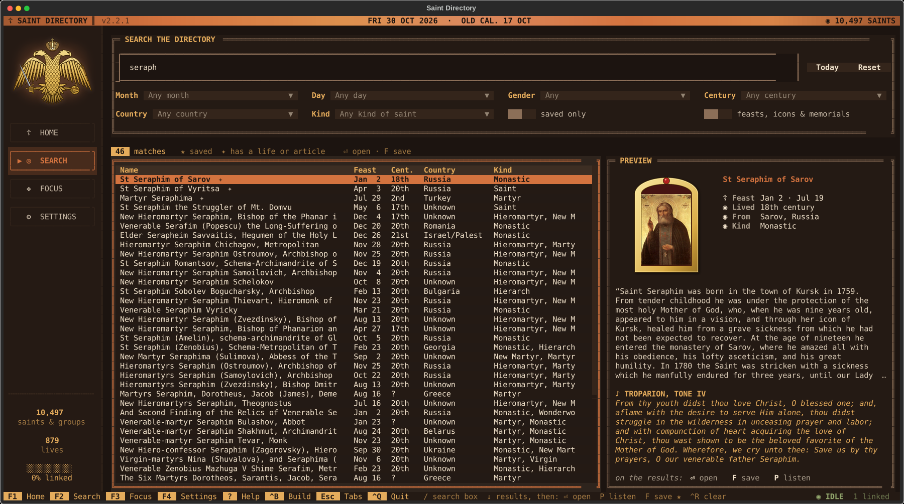
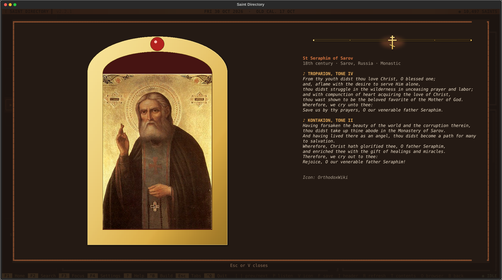
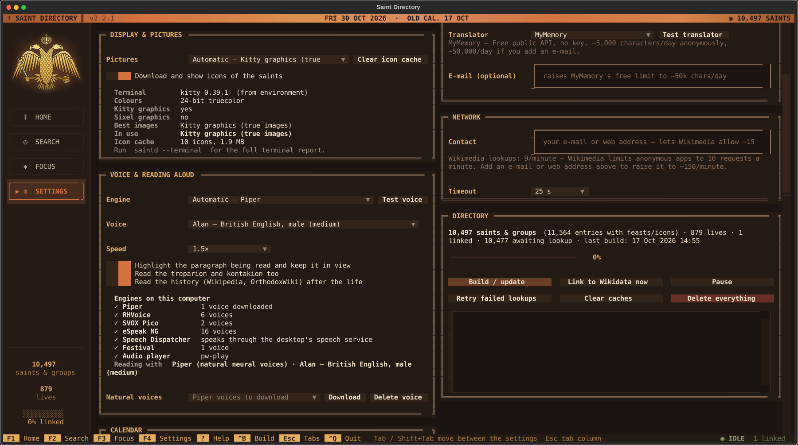

# ☦ Saint Directory (`saintd`)

A retro, earthy terminal guide to the saints of the Eastern Orthodox Church, for Linux.

Saint Directory builds a local directory of **~10,500 saints and groups** from free public sources and opens each one
like a page of the Synaxarion: the saint's **icon**, the **Life**, the **troparion and kontakion**, the **history**
from Wikipedia or OrthodoxWiki, feast days on the New and Old Calendars, and the saints who share them — and it can
**read it all to you aloud**. Home is a full-screen **Church calendar dashboard**: the typikon sign of every day, the
day's fast and readings with the Gospel's text, the saints, a saint of the day, and the feasts and fasts ahead.
Everything is in English — Russian-calendar entries and non-English articles are translated.

```
F1 Home  F2 Search  F3 Focus  F4 Settings  P listen  ? Help  / search box  Esc tab column  ^B build  ^Q quit
```

| Home | Search |
|---|---|
|  |  |
| **Focus** (as drawn in Kitty and Ghostty) | **Reading aloud** |
|  |  |
| **The icon view (V)** | **Settings** |
|  |  |

All twelve colour schemes: [docs/themes.png](docs/themes.png)

---

## What's new in 2.2.1

- The glow behind the double-headed eagle now pulses **only when you switch tabs** — Home, Search, Focus or
  Settings, whether by F1–F4, the tab column, a click on a tab, **/**, or opening a saint (which takes you to
  Focus) — and no longer at every choice you make in a page.

## What's new in 2.2

- **The double-headed eagle.** In Kitty and Ghostty (and Sixel terminals) a gilded **Byzantine double-headed eagle**
  in the tradition of the Greek Orthodox Church now heads the tab column, drawn after the eagle of the Church of
  Greece and Mount Athos: two heads turned outward with hooked beaks, the imperial crown floating above them, wings
  arched at the shoulders with long feathers sweeping down, scaled neck and breast, the **sword** in its right claw
  and the **orb with the cross** in its left. It is painted for the size of your window — larger on tall terminals.
- **The light behind it pulses** when you switch tabs: the glow behind the eagle swells into an aureole of rays and
  fades back. Every step of the light is sent to the terminal once, so the pulse costs nothing while you work.
  
- **The three-bar cross found its place** above the prayers: it heads the column of hymns in Focus and the
  troparion and kontakion in the icon view (**V**), like the headpiece of a page in a service book.
- **Every control checked again** against what the screen says about it (the Help, the key lines, the buttons,
  the dialogs), with new tests for the reading bar's buttons, the voice dialog, the icon view, the Scripture window
  and the Settings voice buttons. Fixed along the way:
  - "Lived 7th century · 7th century": when a source gives a date only as a century it is no longer repeated
    ("born in the 7th century"), and it is read aloud as a sentence ("Died in the 7th century").
  - The Focus welcome now lists **V** (the icon view); under the day's readings Home says "S opens them" (not
    "S reads them", which sounded like reading aloud); the voice dialog and messages name the Settings panel by
    its real title.
  - Choosing a Piper voice to download could be undone by the voice scan finishing a moment later.
  - A message from a background download arriving while saintd was closing could end it with an error.
  - Opening Settings for the first time no longer re-applies its values: it could switch the pictures mode, show a
    needless "Sixel needs a restart" note, or round a timeout or reading speed set in the settings file.
  - Clicking **Contents** twice left the cursor on the button, so the arrow and page keys stopped scrolling.
  - The saint of the day's **Listen** button now says **Pause** and **Resume** while it reads, like Focus's.
  - The Search help and key lines say that **F** and **P** work on the results (in the search box they are
    letters); "(press S for the text)" is no longer shown when the calendar has no text for a reading; the
    "Clear article cache" button, which also clears the download cache, is now called **Clear caches**.

## What was new in 2.1

- **Reading aloud.** Press **P** and the saint's life, hymns and history are read to you, the paragraph being read
  highlighted and kept in view. On Home, **P** reads the whole day: its feasts and fast, the saints, the saint of the
  day and the Epistle and Gospel. **P** pauses and resumes, **X** stops, **,** and **.** skip back and forward a
  paragraph, **+** and **-** change the speed; a bar above the status line shows what is read, how far, the voice
  and the speed, with buttons for the mouse. Six engines: **Piper** (natural neural voices, offline — offered the
  first time you listen), RHVoice, SVOX Pico, eSpeak NG, Speech Dispatcher and Festival. Choose the engine, the
  voice and the speed in **Settings → Voice & Reading aloud**, download Piper voices there, or hear a test.
- **Every screen fills the window.** Home is a three-column dashboard on big terminals: the calendar and the days
  ahead (the coming week and the next feasts and fasts, with Pascha worked out locally); the day's saints as a table
  with century and place; and the saint of the day — icon, facts, life and troparion — above the Gospel and Epistle
  in full. Focus keeps the facts in the header card and puts the hymns, feast days, the saints who share them and the
  sources in a column beside the life. Search shows a **preview** of the highlighted saint beside the results.
  Settings is laid out in two columns.
- **Made for Kitty and Ghostty.** Icons stand in a **gilded, arched frame** with a velvet arch and a jewel, like an
  icon case; a saint without a picture gets a **painted icon blank** — gold leaf, a halo with the initial and the
  name inscribed. A gilded **Orthodox cross** headed the tab column (since 2.2, the double-headed eagle), the title
  bar is a band of burnished gold, and **V** opens the **icon view**: the icon as large as the window allows, with
  the troparion and kontakion beside it.
- **Five new colour schemes**: Paschal Night, Mount Athos, Blue Domes, Theophany (a light scheme) and
  **Liturgical Colours**, which follows the Church year like the vestments do — gold on ordinary days, blue for the
  Theotokos, purple for the Cross and Lent, black in Holy Week, red for Pascha and the martyrs, green for Pentecost,
  white for the Nativity, Theophany and the Transfiguration. Home shows the day's colour too.
- **Fixed:** resizing or maximising the window after saintd started kept the small-terminal layout (an icon-only
  tab column, the narrow Home); the layout now follows the window at once.

## What was new in 2.0

- **Icons of the saints**, drawn as real pictures in **Kitty** and **Ghostty** (Kitty graphics protocol), in
  **WezTerm, foot, Konsole** and other **Sixel** terminals, and as colour mosaics everywhere else.
- **Knows its terminal.** saintd recognises the terminal *and its version* — from the environment and by asking the
  terminal itself (XTVERSION, the Kitty graphics query, cell size and device attributes) — and picks the best
  pictures it can really show: Kitty images need kitty 0.28+ or Ghostty 1.0+, Konsole's Sixel needs 22.04+, and inside
  tmux or screen it falls back to colour blocks. `saintd --terminal` shows what it found.
- **The Church calendar on Home**: a month view with the typikon sign of each day (⊕ great feast, ✠ vigil,
  ✚ polyeleos, ≈ doxology, ∽ six stichera, • fast day), the day's tone, fast, feasts and Scripture readings —
  press **S** to read the Epistle and Gospel themselves.
- **Hymns**: the troparion and kontakion of the saint, with their tone.
- **New sources**: the Orthodox Calendar of Holy Trinity Russian Orthodox Church (English lives by Fr. S. Janos, and
  the hymns), **OrthodoxWiki** (history when Wikipedia has none) and **Wikimedia Commons** / Azbuka Very icons.
- **Focus** has a header card with the icon and the essentials, **[ ]** steps through the list you came from, and
  saints under *Also Commemorated* open with a click.
- **Saved saints ★** — press **F** on a saint on Home, in Search or in Focus; Search can show only your saved
  saints.
- **A cleaner directory**: a saint kept by several calendars on the same day under different titles ("Martyr",
  "Virgin-martyr", "Venerable-martyr Anastasia the Roman") becomes one entry, and Russian-calendar names read as
  English ("Matrona of Thessalonica", "Xenia (Eusebia) of Mylasa", "Olga (Helen)").
- **Search in any alphabet**: *Серафим* or *Σεραφείμ* finds St Seraphim; the wheel and **[ ]** in Focus go
  through all the results, not only the first 200.
- **Help** (**?**) with every key and a glossary of Orthodox terms (hieromartyr, troparion, typikon…) — [screenshot](docs/help.png).
- **Faster and smoother**: about twice as fast to start, pages built when first needed (or while you are idle), the
  calendar moves instantly while the day's details follow, and every source is read in parallel.
- Every letter key works in either case, and Ctrl keys with or without Shift.

---

## Install

You need Linux with **Python 3.10 or newer** (Ubuntu 22.04, Debian 12, Linux Mint 21 and anything newer already have
it), plus `git` and `pipx` for the easiest install:

```bash
sudo apt install git pipx python3-venv         # once (Debian, Ubuntu, Linux Mint)
pipx ensurepath                                 # once, then open a new terminal
git clone https://github.com/BravoDeltaThr33/saintd.git
cd saintd
./install.sh
saintd
```

No git? Click **Code → Download ZIP** at the top of this page, unzip it, open a terminal in the unzipped folder and
run `./install.sh`.

`install.sh` installs with pipx when present (otherwise into a private virtual environment in
`~/.local/share/saintd-venv`, linked into `~/.local/bin`) and adds **Piper** for natural reading voices
(`pipx inject saint-directory piper-tts`). Without Piper, reading aloud uses the voices your system has.

### Upgrading

In the folder you cloned, run `git pull` and then `./install.sh` (or `pipx install --force .` followed by
`pipx inject --force saint-directory piper-tts`). This replaces the program and keeps your directory, settings,
saved saints, linked saints and downloaded voices. New dependencies are downloaded automatically.

To uninstall: `pipx uninstall saint-directory` (and optionally
`rm -rf ~/.local/share/saintd ~/.config/saintd ~/.cache/saintd`).

---

## Pictures in your terminal

| Terminal | Pictures | Notes |
|---|---|---|
| **Kitty** 0.28+ | True images (Kitty graphics) | Best quality |
| **Ghostty** 1.0+ | True images (Kitty graphics) | Best quality |
| WezTerm, foot, Konsole 22.04+, mlterm, xterm `-ti vt340` | True images (Sixel) | Detected from the terminal's answer |
| GNOME Terminal, Xfce Terminal, Tilix, Alacritty, others with 24-bit colour | Colour-block mosaic | Two pixels per character cell |
| Inside tmux / screen | Colour-block mosaic | Multiplexers don't pass images on reliably |
| Linux console | Off | An ornamental frame with the saint's initial |

With true images (Kitty, Ghostty, Sixel) the icons stand in a gilded arched frame, saints without a picture get a
painted icon blank, the gilded double-headed eagle heads the tab column — in Kitty and Ghostty the light behind it
pulses when you switch tabs — the three-bar cross stands above the hymns, and **V** in Focus shows the icon as large
as the window allows.

You can choose yourself in **Settings → Display & Pictures** (Automatic, Kitty, Sixel, Colour blocks or Off), or for
one run with `SAINTD_GRAPHICS=blocks saintd`. Icons are downloaded only when you open a saint (or it is Saint of the
Day) and kept in `~/.cache/saintd/icons`; **Clear icon cache** in Settings empties it.

```bash
saintd --terminal      # what saintd knows about this terminal
```

---

## Reading aloud

Press **P**: in **Focus** the saint is read (name and facts, the life, the troparion and kontakion, then the
calendar notes and the history); on **Home** the day is read (its date and feasts, the fast, the saints, the saint
of the day, and the Epistle and Gospel); in **Search** the highlighted saint. The reading goes on while you move to
other tabs.

| Key | |
|---|---|
| **P** | Start reading — or pause and resume |
| **X** | Stop |
| **,** **.** (or **<** **>**) | Previous / next paragraph |
| **+** **-** | Faster / slower (0.7× – 1.75×) |

| Engine | Sound | Install |
|---|---|---|
| **Piper** | Natural neural voices, offline. Voices (60–115 MB each: Alan, Ryan, Cori, Lessac, Northern English, John, Norman, Jenny…) are downloaded once from the [Piper voices](https://huggingface.co/rhasspy/piper-voices) collection — saintd offers some the first time you listen, and **Settings → Voice & Reading aloud** has them all | `install.sh` adds it; or `pipx inject saint-directory piper-tts`, or **Install Piper** in Settings |
| **RHVoice** | Clear classic voices | `sudo apt install rhvoice rhvoice-english` |
| **SVOX Pico** | A clear female voice (British or American) | `sudo apt install libttspico-utils` |
| **eSpeak NG** | Robotic but light, many accents | `sudo apt install espeak-ng` |
| **Speech Dispatcher** | The desktop's speech service and its voices | Usually installed already |
| **Festival** | The classic Edinburgh system | `sudo apt install festival` |

*Automatic* picks the first that works, in that order. Settings also lists which engines and audio player this
computer has, the voice in use, the speed, and switches for highlighting, the hymns and the history. Sound is played
with `pw-play`, `paplay` or `aplay` (any of them is enough). Abbreviations, Scripture references and regnal numbers
are read in words ("Colossians 4.10-18" → "Colossians, chapter 4, verses 10 to 18"; "Joseph I" → "Joseph the First").

---

## First run

1. **Building the directory** starts automatically (a few minutes the first time; later updates take seconds because
   downloads are cached). You can use the app while it builds — Home and Search fill in as each stage finishes.
2. You'll be asked for an optional **contact e-mail or web address**. Wikimedia (Wikidata/Wikipedia) allows about
   **150 requests a minute** to apps that include contact details in their User-Agent, but only **10 a minute** to
   anonymous ones. The address is sent only to Wikimedia, inside the User-Agent header. You can add or change it
   later in **Settings → Network**, or press **Esc** to skip.
3. After the build, saints are **linked to Wikidata in the background** (dates, birthplaces, pictures, Wikipedia
   articles). Opening a saint in Focus always looks it up immediately.

---

## The tabs

The **tab column** on the left has the cursor when saintd starts: **Tab / Shift+Tab** (or ↑ ↓) move between tabs and
**Enter** (or →) steps into the page; **Esc** brings you back to it. **F1–F4** open a tab from anywhere. The page's
own keys (T, N, [ ], …) also work while the cursor is on the tab column.

| Tab | What it shows |
|---|---|
| **Home** | The Church calendar (with the Old Calendar date), the day's feasts, tone, fast, season and Scripture readings; the week ahead and the next feasts and fasts; the saints commemorated that day (century, place, ✦ life, ♪ hymns); a Saint of the Day with an icon, facts, the Life and the troparion; and the Gospel and Epistle in full. |
| **Search** | Type a name or part of one (spelling variants match: *athanasios* finds *Athanasius*, *cyril* finds *Kirill*). Filter by feast month/day, gender, century, country and kind of saint (Martyr, Hieromartyr, Monastic, Hierarch, Royal, Fool-for-Christ, Unmercenary…), or show only your saved saints. ✦ marks saints with a Life or article, ★ your saved ones. On wide terminals a preview of the highlighted saint stands beside the results. |
| **Focus** | One saint: a header card with the icon and every fact (feast days, Old Calendar date, dates, place, kind, sources); then the Life (from the Synaxarion, the Holy Trinity calendar, the Mystagogy Resource Center or Azbuka Very), the Hymns, the History (Wikipedia or OrthodoxWiki, translated if needed), the commemorations, the saints who share the day, and every source with its licence — on wide terminals the hymns, feast days and sources stand in a column beside the life. |
| **Settings** | Colour scheme and symbols, pictures, voice & reading aloud, New/Old Calendar, which sources to use, translator, network contact and timeout, directory maintenance (build, link, pause, retry, clear caches, delete) and information about every source. |

## Keys

Letter keys work in either case. The mouse works too: click tabs, buttons, days and saints, scroll with the wheel.

| Everywhere | |
|---|---|
| **F1 F2 F3 F4** | Home, Search, Focus, Settings |
| **/** | Jump to the search box |
| **?** | Help (press **?**, **Esc** or **Q** to close) |
| **Esc** | Put the cursor on the tab column |
| **Ctrl+B** | Build or update the directory |
| **Ctrl+Q** | Quit |
| **P** / **X** | Listen (pause, resume) / stop reading — see [Reading aloud](#reading-aloud) |

| Home | |
|---|---|
| **← → ↑ ↓** | Move the day on the calendar (when the calendar has the cursor) |
| **PgUp / PgDn** | Previous / next month (on the calendar) |
| **[ ]** | Previous / next day, from anywhere on Home |
| **T** (or **Home** on the calendar) | Today |
| **S** | The day's Scripture readings, with their text |
| **N** | A random saint |
| **P** | Listen to the day |
| **C / L / G** | Cursor to the calendar / to the list of the day's saints / to the Gospel and Epistle |
| **Enter** | Open the highlighted saint (on the calendar: go to the day's list) |
| **F** | Save / unsave the highlighted saint ★ (or the Saint of the Day) |

| Search | |
|---|---|
| **/** or **Ctrl+F** | Cursor to the search box |
| **Enter** | In the box: go to the results. On a result: open it in Focus |
| **↓** | From the search box down to the results |
| **F** | Save / unsave the highlighted saint ★ (on the results) |
| **P** | Listen to the highlighted saint (on the results) |
| **Ctrl+R** | Clear the search and every filter |

In the search box every letter is typed into the search; **↓** or **Enter** takes you to the results, where the keys
above work.

| Focus | |
|---|---|
| **↑ ↓ PgUp PgDn Home End** | Scroll the article |
| **Space** | One page down |
| **[ ]** | Previous / next saint of the list you came from |
| **P** | Listen: the life, hymns and history read aloud |
| **V** | The icon view: the icon as large as the window allows, with the hymns (or click the icon) |
| **F** | Save / unsave the saint ★ |
| **I** | Show or hide the header card (its facts then move into the article) |
| **R** | Refresh from the internet |
| **T** | Table of contents |
| **O** | Open the saint's page in your web browser |
| **B** | Back to the search results or the day's list, on the same saint |

### Colour schemes

| Theme | Palette |
|---|---|
| **Terracotta Kiln** | fired clay, ochre glaze and sage |
| **Moss & Lichen** | forest-floor greens over damp stone |
| **Desert Ochre** | sun-baked sand, rust and desert sage |
| **Icon Umber** | icon gold leaf, cinnabar and verdigris on walnut |
| **Cedar & Peat** | smoked cedar, olive branch and parchment |
| **Byzantine Empire** | porphyry purple, the gold ground of the mosaics, lapis blue and ivory |
| **Roman Empire** | legion crimson and eagle gold on Pompeian black, with laurel and Carrara marble |
| **Paschal Night** | candle flames, Paschal red and white lilies under the midnight sky |
| **Mount Athos** | monastic black, beeswax, olive groves and the Aegean |
| **Blue Domes** | the starry blue domes and gold stars of the Lavra, with brick |
| **Theophany** (light) | white garments, Jordan blue and gold, on ivory |
| **Liturgical Colours** | changes with the Church year like the vestments (after Russian use; customs differ): gold, blue, purple, green, white, red or black |

Themes use 24-bit colour, which most terminals support. If your font lacks symbols such as ☦ or ⚙, choose
**Plain ASCII** symbols in Settings. The layout adapts from 80×24 up; on small terminals the tab column shows icons
only.

---

## Where the information comes from

No API keys and no subscriptions are needed.

| Source | Language | Used for | Terms |
|---|---|---|---|
| [Orthocal](https://orthocal.info/api/) | English | The calendar of saints (OCA/Slavic and Greek traditions), lives of the saints, the typikon rank, tone, fast and Scripture readings of every day (KJV) | Free public API |
| [Holy Trinity Orthodox Calendar](https://www.holytrinityorthodox.com/calendar/) (Holy Trinity Russian Orthodox Church, Baltimore) | English | Lives translated by Fr. S. Janos, and the troparia and kontakia — read only for the saint you open, through the calendar script the parish offers to other sites, and cached | © the parish and translator; credited and linked |
| [Wikipedia's Orthodox calendar](https://en.wikipedia.org/wiki/Eastern_Orthodox_liturgical_calendar) — the 366 "*Month day* (Eastern Orthodox liturgics)" pages | English | Most of the directory: every commemoration of the Great Synaxaristes, Russian, Georgian, Serbian and Romanian saints, the pre-Schism Western saints and the New Martyrs | CC BY-SA 4.0 |
| [Azbuka Very](https://azbyka.ru/days/) | Russian → English | Extra saints of the Russian calendar (many New Martyrs), the saint's Life when no English one exists, icons | Public pages |
| [Mystagogy Resource Center](https://www.johnsanidopoulos.com/) (John Sanidopoulos) | English | Lives for saints the calendars have none for, especially Greek saints and New Martyrs | © its author; credited and linked |
| [OrthodoxWiki](https://orthodoxwiki.org/) | English | The History section when Wikipedia has no article; always listed in Sources when it has one | GFDL / CC BY-SA 2.5 |
| [Wikidata](https://www.wikidata.org/) | Multilingual | Gender, dates, birthplace and country, English names, the saint's picture, Wikipedia links | CC0 |
| [Wikipedia](https://www.wikipedia.org/) | English (others translated) | The History section | CC BY-SA 4.0 |
| [Wikimedia Commons](https://commons.wikimedia.org/) | — | Icons (the saint's Wikidata picture) | As given for each file |
| Translator of your choice | Any → English | Non-English articles and Russian lives | See below |

### Lives for lesser-known saints

When you open a saint, Focus looks in every source at once and shows each answer as it arrives:

1. **Orthocal** and the **Holy Trinity calendar** — the calendars' own lives (the right namesake is chosen by name,
   place, title and rank).
2. **The Mystagogy Resource Center** — used only when a post's title names the saint *and* a second name or place
   matches, or it was published on the feast day, and only if it is a life (not a homily or a photo post).
3. **Azbuka Very** — for saints of the Russian calendar, the short Life, machine-translated.
4. **Wikipedia** or **OrthodoxWiki** — the history.

Each is fetched once and kept, so opening the saint again is instant; **R** looks again. Every source can be turned
off in **Settings → Sources**. Many saints really are known only by name, rank and day — the Synaxarion records
nothing more — and their page says so.

**Feast days** are church dates. Old Calendar (Julian) churches keep each one 13 days later on the civil calendar;
Home and Focus show both. Pick your calendar in Settings.

### Translation

Russian calendar entries are always shown in English using a built-in glossary of church titles and names. A
translator is used for whole non-English Wikipedia articles and Russian lives. Choose one in
**Settings → Translation**:

| Translator | Notes |
|---|---|
| **MyMemory** (default) | Free, no key. About 5,000 characters/day anonymously, ~50,000/day if you add an e-mail. |
| **Lingva** | Free open-source front-end; public instances come and go — set one that works for you. |
| **LibreTranslate** | Free when self-hosted: `docker run -p 5000:5000 libretranslate/libretranslate` |
| **Ollama** (local) | A model on your own machine — unlimited and offline. Install Ollama, `ollama pull qwen3:8b` (or any model), then press **Detect** in Settings. |
| **Off** | Built-in glossary only. |

---

## Command line

```bash
saintd                 # start the app
saintd --terminal      # what saintd detects about this terminal (name, version, colours, pictures)
saintd --sync          # build or refresh the directory, then exit
saintd --rebuild       # rebuild from scratch (reuses downloaded data)
saintd --enrich        # link saints to Wikidata now (add a number to stop after N)
saintd --stats         # print directory statistics
saintd --reset         # delete the local directory and caches
saintd --version
```

### Where saintd keeps its files

| What | Where |
|---|---|
| The directory, lives, articles, saved saints, downloaded API responses and translations (one SQLite file, about 50 MB) | `~/.local/share/saintd/saints.db` |
| Your settings (theme, calendar, pictures, sources, translator, contact) | `~/.config/saintd/config.json` |
| Downloaded icons (safe to delete) | `~/.cache/saintd/icons/` |
| Downloaded Piper voices | `~/.local/share/saintd/voices/` |
| The program itself (pipx install) | `~/.local/share/pipx/venvs/saint-directory/`, started by `~/.local/bin/saintd` |
| The program itself (`install.sh` without pipx) | `~/.local/share/saintd-venv/`, started by `~/.local/bin/saintd` |

Copy `saints.db` to back up your linked directory and saved saints. Set `SAINTD_HOME` to keep data, settings and
cache somewhere else.

---

## Troubleshooting

- **"No calendar could be downloaded"** — the first build needs the internet. saintd tries again every time it
  starts until the directory is built; **Ctrl+B** tries at once. If only some downloads failed, the next start
  completes the directory.
- **No pictures in Kitty or Ghostty** — run `saintd --terminal`. Kitty images need kitty 0.28 or newer (Ghostty 1.0 or
  newer) and don't pass through tmux/screen; saintd then uses colour blocks. You can force a mode in Settings or with
  `SAINTD_GRAPHICS=kitty saintd`.
- **Lookups are slow / "asked us to slow down"** — Wikimedia is rate-limiting. Add a contact in Settings → Network;
  saintd always honours Wikimedia's `Retry-After` and keeps going.
- **"MyMemory daily free quota used up"** — add an e-mail in Settings → Translation, switch to Ollama, or wait a day.
- **A saint appears twice** — the calendars sometimes name the same saint differently (Gall / Gallus). Linking to
  Wikidata merges such duplicates as it works through the directory.
- **Boxes instead of symbols** — Settings → Color Scheme → Symbols → Plain ASCII.
- **Reading aloud is silent** — Settings → Voice & Reading aloud lists the engines and the audio player found; press
  **Test voice**. With no player, `sudo apt install pipewire-bin` (or `pulseaudio-utils`). With no engine,
  `sudo apt install espeak-ng`, or install Piper there.
- **The layout looks cramped** — the dashboards appear from about 150×34 characters; maximise the window or use a
  smaller font. The layout follows the window as you resize it.

---

## Development

```bash
python3 -m venv .venv && . .venv/bin/activate
pip install -e .
saintd
```

The code is in `saintd/`: `sources.py` (API clients), `sync.py` (building and Wikidata linking), `wikical.py`
(Wikipedia's Orthodox calendar pages), `lives.py` (Mystagogy and Azbuka Very lives), `htc.py` (the Holy Trinity
calendar), `owiki.py` (OrthodoxWiki), `icons.py` (finding and caching icons), `term.py` (terminal detection),
`graphics.py` (Kitty, Sixel and colour-block pictures, the eagle's pulse), `art.py` (the gilded frames, icon
blanks and the cross headpiece), `eagle.py` (the double-headed eagle and its steps of light),
`themes.py` (colour schemes and liturgical colours), `paschalion.py` (Pascha, feasts and fasts), `tts.py` (reading
aloud: engines, voices, players and the reader), `piper_worker.py` (Piper in its own process), `narration.py` (what is
read), `ru.py` (Russian → English), `heuristics.py` (titles → facts), `article.py` (the Focus article),
`translate.py`, `db.py`, `net.py` (rate-limited HTTP), and `ui/` with `saintd.tcss` for the Textual interface.

---

## License

MIT — see [LICENSE](LICENSE). Saint Directory is an independent hobby project, not affiliated with or endorsed by
any church, parish or publisher, or by any of the sources it reads. Their texts, icons and names belong to their
owners and are shown under each source's own terms, credited and linked (see
[Where the information comes from](#where-the-information-comes-from)). Found a mistake in a saint's entry, or run
one of the sources and want something changed? Please open an issue.
